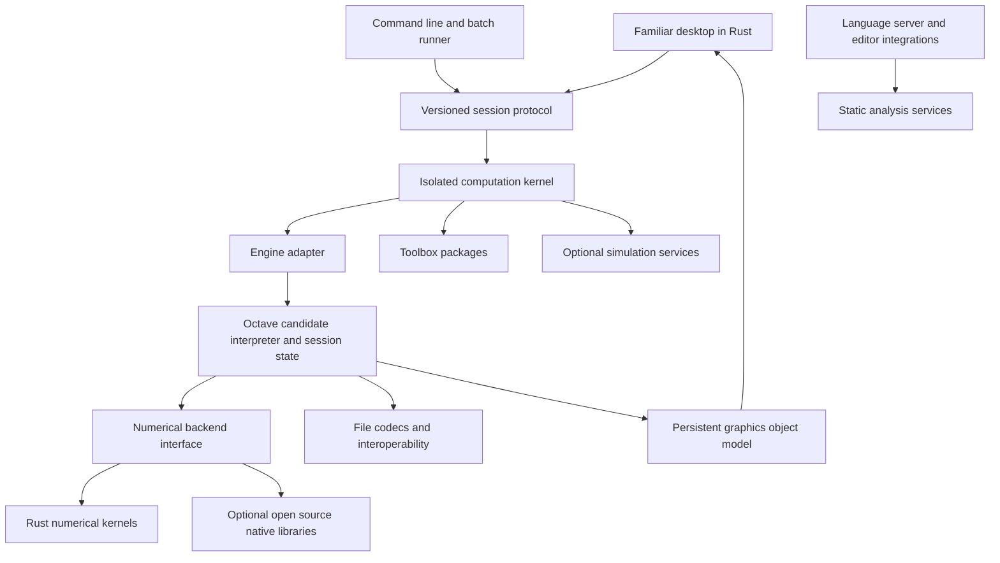

# Open source MATLAB compatible platform development plan

Planning baseline: October 14, 2026. Implementation status: an integrated Rust desktop and CLI alpha now runs GNU Octave, with script execution, workspace previews, MAT files, figure previews and package loading. See [README](README.md) for the implemented scope and [validation evidence](artifacts/VALIDATION.md) for checked behavior. The remaining sections describe the full development target.

Build an open-source scientific computing platform by integrating an existing MATLAB-compatible engine, tested scientific packages, and a familiar desktop written in Rust. Evaluate GNU Octave as the primary engine before investing in a new interpreter. A MATLAB user should be able to begin ordinary work without learning a different language or rearranging their workflow.

The recommended delivery approach is defined in [Integration strategy](INTEGRATION_STRATEGY.md). A Rust-native interpreter is an optional future project; it is not a prerequisite for the first useful release. An integrated Octave-based distribution will contain multiple implementation languages and must not be marketed as entirely Rust.

This is a substantial engineering program. A useful compatible core is feasible; complete compatibility with every MATLAB release, toolbox, binary extension, hardware target, and hosted service cannot responsibly be promised in advance. Performance improvements must be demonstrated on named workloads. Rust does not automatically make numerical algorithms faster.

The companion [functionality catalog](FUNCTIONALITY_CATALOG.md) specifies the proposed functional workstreams, concrete APIs, interface requirements, file support, and acceptance criteria. It is a starting engineering inventory, not an audited enumeration of every MathWorks API. Completing that enumeration is the first milestone.

## Product requirements

The user has established these priorities:

1. Include the whole MATLAB, toolbox, and Simulink ecosystem in the long-term roadmap, delivered in stages.
2. Choose implementation technology for functionality, reliability, and performance. Use Rust wherever practical; evaluate established open-source native dependencies where they materially improve the result.
3. Make the interface familiar enough for an experienced MATLAB user to start working without a tutorial.
4. Combine existing open-source projects where this accelerates a dependable, comprehensive product.

Proposed product rules:

- The core application works offline and requires no MathWorks runtime, account, license server, or proprietary numerical library.
- All code distributed as part of the project is available under compatible open-source licenses. Ordinary operating-system interfaces and device drivers are documented platform dependencies.
- The default language mode follows a declared MATLAB release profile. Optional language extensions require explicit opt-in and do not change compatible behavior.
- Windows, macOS, and Linux are first-class desktop targets. Exact OS versions and supported processor architectures are pinned per release.
- Every compatibility claim names its release, API signatures, types, platform, and tested limitations.
- Opening an unsupported object or model produces a specific diagnostic. Never silently discard data or pretend an unsupported feature worked.
- Ship useful, tested releases as the ecosystem grows. A release number never implies complete MathWorks product parity.

MathWorks separates MATLAB, Simulink, and many specialized products; this project must track those boundaries rather than treating them as one function library. See the [official product catalog](https://www.mathworks.com/products/alphabetical.html) and [MATLAB documentation map](https://www.mathworks.com/help/matlab/).

## Compatibility contract

Use R2026b as the proposed initial documentation baseline, subject to obtaining a suitable licensed reference environment for testing. Record the actual reference build and platforms. Freeze that baseline for each project release; add older or newer profiles deliberately. Documentation being available is not evidence that a behavior has been reproduced.

Compatibility has separate dimensions:

| Dimension | Required evidence |
| --- | --- |
| Source language | Unmodified source parses and executes with the expected scoping, dispatch, indexing, and mutation rules. |
| Function API | Supported signatures, defaults, optional arguments, output counts, classes, shapes, warnings, and errors match the selected profile. |
| Numerical behavior | Results satisfy method-specific accuracy and convergence criteria; exact outputs are required only where meaningful. |
| Data files | Supported versions and object types survive read and write round trips with class, shape, metadata, and missing values preserved. |
| Graphics | Object hierarchy, properties, callbacks, and interactions behave compatibly; visual rendering has documented tolerances. |
| Desktop workflows | Existing users complete familiar tasks using familiar terms, locations, keyboard actions, and feedback. |
| Extensions | Source-level interoperability and binary interoperability are reported separately. |
| Simulation | Imported model semantics, solver settings, events, timing, and outputs agree for supported blocks. |

Do not use “runs a sample script” as a substitute for this contract. For example, implementing `sum(A)` does not establish support for every dimension argument, input class, missing-data option, sparse case, or accumulation behavior.

Create a machine-readable compatibility registry before implementation expands. Each record must include:

```text
id, product, reference_release, feature_kind, symbol_or_workflow,
signature_or_variant, input_classes, shape_rules, options_and_defaults,
outputs, warnings_and_errors, platform_constraints, dependencies,
reference_url, implementation_status, test_ids, known_deviations,
owner, milestone
```

Use statuses `unassessed`, `specified`, `partial`, `conformant`, `divergent`, and `blocked`. A blocked item remains visible in the scope denominator. Report coverage by API variant, file class, workflow, and representative project; avoid a misleading single percentage.

Full parity with a frozen scope means every in-scope record satisfies its acceptance criteria, including non-function features and applicable platform behavior. Adding another MathWorks release creates new work rather than silently changing the denominator.

## Interface familiarity

Ship a default Familiar Desktop layout. Preserve familiar labels and spatial relationships: Current Folder and file browsing at the left, Editor and Command Window in the main area, Workspace and variable inspection alongside them, and accessible Command History, Help, and figure windows. Confirm the exact reference arrangement during the first UX study because MATLAB desktop layouts and shortcuts vary by release, OS, and customization.

Support docking, undocking, resizing, saved layouts, multiple monitors, light and dark themes, high-DPI scaling, and layout reset. Existing users should not need a new project wizard, a package install, or an account before entering `A = [1 2; 3 4]` and inspecting `A`.

Match behavior as well as appearance:

- Command history navigation, multiline entry, completion, semicolon output suppression, `ans`, contextual help, and interrupting running code.
- Open and run `.m` files; run a selection or section; show errors with navigable file and line locations.
- Set breakpoints from the gutter, step through code, inspect variables, and view the call stack.
- Double-click workspace values to inspect or edit them; preserve shape and class while editing.
- Use familiar figure controls for zoom, pan, data tips, legends, axes limits, and export.
- Provide a documented MATLAB-style shortcut profile, verified on each OS, with remapping and conflict reporting.
- Keep long calculations out of the UI event loop. A busy kernel must not prevent editing, inspecting previous results, or requesting cancellation.

Use original branding and assets. Familiarity is a workflow requirement; copying visual assets is unnecessary. Put optional improved workflows behind discoverable commands without disrupting the familiar defaults.

Proposed usability gate: recruit at least eight existing MATLAB users from mixed application areas. Ask them, without a tutorial, to open a script, run a section, fix an error, set a breakpoint, inspect a matrix, load data, edit a plot, export it, and save/reopen their work. Require at least 90% unassisted task completion overall, no critical workflow blockers, and investigate tasks whose median completion time exceeds 1.25 times the same users' MATLAB baseline. These are proposed product targets, not measured results.

Accessibility, keyboard navigation, input methods, text selection, clipboard behavior, screen-reader support, and large-file editing are framework selection criteria. They must be tested before committing to a GUI library.

## Architecture

Use a modular Cargo workspace for the desktop, session service, adapters and new Rust components. Start with a separately running worker that hosts the selected existing interpreter. The first deployment is a local desktop plus a command-line tool; a browser client and remote execution can reuse the protocol later. One interpreter owns each session's variables, handles and evaluation order.



Proposed module boundaries:

| Module | Responsibility |
| --- | --- |
| `syntax` | Lexer, parser, lossless syntax tree, source spans, formatting support. |
| `semantics` | Name resolution, scopes, imports, language-profile rules, analysis. |
| `values` | MATLAB-compatible arrays, containers, objects, handles, and conversion rules. |
| `runtime` | Function dispatch, stack frames, exceptions, paths, lifecycle, cancellation. |
| `vm` | Inspectable bytecode execution and debugger hooks. |
| `compiler` | Guarded specialization, typed IR, JIT, cache invalidation, fallback. |
| `numerics` | Dense and sparse operations, FFT, solvers, backend selection. |
| `stdlib` | Public function contracts and MATLAB behavior adapters. |
| `io` | MAT codecs, text and binary formats, import/export adapters. |
| `graphics` | Persistent figures, axes, objects, property changes, exports. |
| `protocol` | Versioned messages, session IDs, kernel events, bounded data transfer. |
| `kernel` | Headless process, jobs, interrupts, session management. |
| `desktop` | Familiar desktop panels, editor, variable viewer, figures, preferences. |
| `language-server` | Completion, diagnostics, navigation, symbol search, rename. |
| `packages` | Dependency resolution, registries, lockfiles, integrity metadata. |
| `simulation` | Model graph, execution schedule, continuous and discrete solvers. |
| `conformance` | Reference comparisons, fixtures, regression reports, coverage registry. |

The module table is a responsibility map for the eventual platform. Initially, the selected engine supplies parsing, semantics, values, execution, most numerical functions and graphics objects. Project-owned crates concentrate on the protocol, engine adapter, desktop, packaging and conformance. Compiler/VM replacements remain optional and must not delay the integrated release.

### Language and value representation

Initially, preserve the selected engine's values inside its worker and specify a lossless transport representation for desktop inspection and service calls. If a Rust-native runtime is later justified, build one MATLAB-aware array model instead of exposing a numerical library's array semantics directly. It must represent at least two dimensions, column-major linear indexing, element class, complex values, sparse storage, shape, strides, and ownership. An internal view is allowed only when it preserves observable value semantics.

Use copy-on-write where appropriate for ordinary arrays. Design handle-object identity and shared mutation separately. Closures and handle graphs can contain cycles, so reference counting alone is not a complete memory-management design. Select and test cycle handling before exposing unrestricted object graphs.

The parser must handle context-sensitive ambiguities such as apostrophe versus string delimiters, command syntax, matrix concatenation whitespace, and indexing versus function calls. Do not implement the language as regular-expression substitution or a direct text translation to Rust.

Reuse the existing interpreter first. Close demonstrated compatibility gaps in adapters, packages or upstream engine changes. If a replacement becomes justified, implement a correct interpreter before specializing hot paths. Compiled paths need guards for types, shapes, function resolution, and mutable definitions, with a tested fallback to interpreted execution. Preserve debugger source mapping.

### Numerical backends

Own the public semantics and numerical error reporting. Keep backend data conversion explicit and measure its cost. Avoid repeated copies between runtime arrays and libraries.

Proposed candidates to benchmark:

| Area | Candidate | Decision rule |
| --- | --- | --- |
| Dense linear algebra | [faer](https://faer.veganb.tw/), plus an optional BLAS/LAPACK backend | Choose per supported operation and hardware after correctness, threading, memory, and speed comparisons. |
| FFT | [RustFFT](https://github.com/ejmahler/RustFFT) | Validate normalization, dimensions, complex conventions, awkward lengths, and numerical accuracy. |
| Advanced numerical coverage | [LAPACK](https://www.netlib.org/lapack/index.html) and selected domain libraries | Reuse established open-source algorithms through narrow adapters where Rust coverage is insufficient. |
| MAT 7.3 container access | [HDF5](https://github.com/HDFGroup/hdf5) through a Rust adapter | Implement MATLAB-specific encoding above HDF5; the container library alone is insufficient. |
| JIT | [Cranelift](https://cranelift.dev/) | Prototype startup cost, steady-state speed, debugging, and target support before adoption. |
| Desktop | [egui/eframe](https://github.com/emilk/egui) as an initial candidate | Pass editor, docking, accessibility, text-input, and large-table usability tests first. |
| Interactive rendering | [wgpu](https://wgpu.rs/) | Test native GPU portability and a usable software/headless path. |

faer is a Rust linear algebra library; RustFFT is implemented in Rust; Cranelift is a Rust compiler backend. Their availability reduces implementation work but does not establish MATLAB compatibility. All version pins, transitive licenses, native dependencies, and platform support need review before adoption.

Use one scheduling policy across numerical calls to avoid nested thread-pool oversubscription. GPU rendering and GPU numerical computation are separate capabilities. Do not assume a portable graphics backend supplies the double-precision performance or numerical operations required by every computation.

A future Rust-only computational build would need its own interpreter and explicit feature matrix; it is not part of the initial Octave-based distribution. The recommended distribution contains non-Rust dependencies and must be described accurately as Rust-based, not 100% Rust. Replacing proven numerical or file-format libraries is a separately justified project, not an automatic priority.

### Kernel and graphics

Preserve the engine's persistent graphics object tree and existing renderer initially. Bridge supported figure interactions into the Rust desktop only after validating object lifecycle and event ordering. `plot`, `set`, callbacks, figure restoration, and export must operate on the same objects. Rendering a picture without implementing object semantics is insufficient.

The desktop requests slices of large arrays rather than serializing entire variables to display a few rows. Messages carry typed metadata and cancellation IDs. Keep callbacks, timers, graphics updates, and debugger pauses consistent with a documented event model.

Local kernel process isolation enables interruption, restart, and crash containment; it is not by itself a security sandbox. Optional untrusted-code execution needs explicit filesystem, process, network, resource, and native-extension policies.

## Open source projects to learn from

| Project | Relevant lessons | Boundary |
| --- | --- | --- |
| [GNU Octave](https://octave.org/about) | MATLAB-like language behavior, numerical interfaces, package organization, user migration. | Mostly compatible does not mean a definitive oracle for every MATLAB behavior; respect its GPL licensing. |
| [Scilab and Xcos](https://www.scilab.org/software/xcos) | Block diagram editing, hybrid simulation, separation of model and solver. | Similar scientific workflows do not establish `.m` or Simulink model compatibility. |
| [Nelson](https://nelson-lang.github.io/nelson-website/) | Numerical desktop, MAT interchange, extension interfaces, graphics and data handling. | Verify each claimed interoperable feature against the selected MATLAB baseline. |
| [OpenModelica](https://openmodelica.org/) | Equation-based modeling, physical simulation, model compilation and diagnostics. | Modelica interoperability is a separate target from Simulink or Simscape compatibility. |

Study documented behavior, published algorithms, architecture, and appropriately licensed tests. Reuse compatible open-source crates and libraries. Reimplement selected components in Rust where that creates a measurable benefit.

Translating an existing implementation into another language does not erase its license obligations. Keep provenance records for imported or adapted code, tests, and assets. Build compatibility from public specifications and independently authored tests; do not copy proprietary MATLAB implementation code. Octave itself documents this boundary in its [contribution governance](https://octave.org/governance).

The application uses GPL-3.0-or-later, with the full license included in the repository. Third-party components retain their original licenses and notices. The local bundle includes corresponding project source and a dependency inventory; future distribution work must also account for any bundled numerical runtimes, packages and platform libraries.

## Development stages and release gates

These are ordered deliverables. The whole ecosystem remains in scope, but later stages are large programs with their own releases.

| Stage | Deliverable | Exit gate |
| --- | --- | --- |
| S0 | Compatibility specification and integration feasibility | Freeze baseline, inventory APIs and candidate packages, establish fixtures, prove engine/UI integration, select license and dependency policy. |
| S1 | Headless integrated foundation | Package the selected engine and curated dependencies; expose structured execution, variables, errors and cancellation; measure compatibility against fixtures. |
| S2 | Familiar desktop alpha | Run scripts, inspect variables, debug, load/save supported MAT types, and create/edit/export ordinary figures through a responsive desktop. |
| S3 | Core scientific release | Deliver the frozen core API set, tables/time handling, broader numerical routines, reliable files and graphics, projects and package tooling; pass migration projects. |
| S4 | Initial engineering and analysis toolboxes | Deliver independently versioned signal, statistics, optimization, control, image, and symbolic subsets with domain-specific validation. |
| S5 | Parallel computing and deployment | Deliver tested parallel constructs, selected GPU operations, remote jobs, application packaging, and declared interoperability targets. |
| S6 | Simulation platform | Deliver block diagrams, solvers, events, a supported Simulink import subset, state machines, and later physical modeling. |
| S7 | Specialized ecosystem expansion | Expand hardware, communications, robotics, automotive, aerospace, finance, biology, verification, and industrial deployment against separate compatibility matrices. |

Some teams can develop independent toolbox specifications or simulation infrastructure once foundational interfaces stabilize. Do not delay usable core releases until every specialist domain is complete.

### First implementation milestone

The first integrated demo should open and run this original compatibility fixture unchanged, display variables in the Workspace, show an interactive figure, and read back the saved data:

```matlab
A = [4 1; 1 3];
b = [1; 2];
x = A \ b;
t = linspace(0, 2*pi, 500);
y = sin(t);
plot(t, y);
title('Sine wave');
xlabel('Time');
ylabel('Amplitude');
save('session.mat', 'A', 'b', 'x', 't', 'y');
clear;
load('session.mat');
```

Acceptance also requires verifying `x` against a known solution and residual, validating the MAT file in a second reader, and interrupting an intentionally long script without freezing the desktop. This is a vertical demonstration, not proof of general compatibility.

### First twelve weeks

Assumption: a funded team of approximately six to ten experienced engineers, including numerical and compiler expertise. This is a proposed work sequence, not a promise of a production release in twelve weeks.

| Period | Work and reviewable output |
| --- | --- |
| Weeks 1–2 | Freeze core profile; test representative projects in candidate engines; inspect package licenses/dependencies; prototype debugger/graphics hooks; select an engine only after evidence. |
| Weeks 3–4 | Build a structured worker adapter, session lifecycle, REPL execution, typed variable inspection, errors and cancellation. |
| Weeks 5–6 | Integrate familiar desktop panels, file/section execution, source diagnostics, workspace inspection and initial debugger controls. |
| Weeks 7–8 | Validate engine figures, MAT round trips, package lockfiles and a first curated toolbox set. |
| Weeks 9–10 | Close prioritized compatibility gaps; test distributions on supported platforms; investigate graphics event integration and large-array transfer costs. |
| Weeks 11–12 | Run migration projects and existing-user usability sessions; publish correctness/performance findings; deliver an integrated alpha if release gates pass; revise estimates. |

If semantic correctness or numerical validation is behind, defer polished UI features and JIT work. Keep the architecture boundaries, but reduce the first supported subset explicitly.

## Performance and reliability

Optimize measured bottlenecks in this order: algorithm selection, allocation and copying, memory locality, vectorization, coarse parallelism, specialization/JIT, and then GPU offload where data size justifies transfers. The actual order may change after profiling.

Candidate improvements include lower startup overhead, smaller resident memory, fewer array temporaries, fused operations where semantics permit, faster scalar loops, responsive large-array inspection, and more efficient rendering. These are hypotheses to test.

Maintain separate benchmark suites for startup, small scalar loops, matrix multiplication, dense and sparse solves, FFT, table operations, MAT loading, plots, model simulation, and complete user projects. Publish the hardware, OS, compiler, library versions, input distributions, thread counts, precision, warm-up policy, peak memory, and accuracy results. Compare cold and warm execution separately.

Do not enable reassociation, reduced precision, nondeterministic reductions, or approximate algorithms invisibly to win benchmarks. A faster backend must still meet the selected compatibility and numerical requirements.

Validation layers:

1. Independently authored semantic tests covering shapes, classes, empty data, missing values, errors, and mutation.
2. Differential tests against a properly licensed MATLAB environment, where available; do not redistribute restricted reference software.
3. Cross-checks against independent mathematical results and alternative implementations. The selected engine's own tests provide regression evidence, not an independent oracle for MATLAB compatibility; disagreements require investigation.
4. Numerical tests using residuals, backward error, conditioning, convergence, and appropriate invariants. Eigenvectors may differ by sign or basis while representing a correct solution.
5. Property tests and fuzzing for parsers, indexing, file readers, and optimized execution.
6. File interoperability tests in both directions, including malformed, truncated, nested, and large files.
7. End-to-end desktop, accessibility, graphics object, export, and crash-recovery tests.
8. Representative unmodified user projects, with permission and clear dependency manifests.

Every release must pass all mandatory tests for its declared subset on supported platforms; disclose unresolved deviations instead of silently excluding failures. Benchmark results cannot compensate for wrong answers.

## Team and duration

Rough planning ranges, not commitments: a focused prototype may take months; a dependable core product may take one to three years with a sustained multidisciplinary team; broad toolbox and simulation coverage is likely a five-to-ten-plus-year program with multiple specialist teams. Comprehensive parity is open-ended and may be blocked in specific proprietary or hardware-dependent areas. Re-estimate after S0 and the first integrated milestone.

Required ownership spans language/runtime, numerical methods, desktop/editor/accessibility, plotting/rendering, data formats, compatibility testing, infrastructure/releases, simulation, and individual scientific domains. A single engineer can build a useful subset, but should not plan as though one person can promptly reproduce the complete ecosystem.

Open-source sustainability requires published design decisions, contribution rules, issue triage, reproducible builds, documentation, security reporting, review ownership, package compatibility policy, and long-term maintenance funding. AI-assisted development can accelerate implementation and tests; it does not replace numerical validation or domain expertise.

## Immediate decisions

The initial Open MathLab alpha uses GNU Octave, a Rust desktop and CLI, and GPL-3.0-or-later licensing. The current implementation is tested on macOS arm64; other platforms, access to licensed MATLAB reference testing, formal usability assessment and the staffing/funding model remain to be established for broader releases.

The integration alpha now demonstrates persistent script execution, bounded matrix inspection and edits, original-source errors, workspace-preserving Unix interruption, figure previews and selected MAT round trips. Its optional native debugger handles saved or unsaved script statements, forward local and nested functions, and cold retained handles across source generations. Ordinary function/class buffers require saving before breakpoint binding. Public breakpoint-table aliases in the inactive registry preserve Continue and normal clear lifetimes; enabled engine checks cover parse failures and requested Quit recovery.

Registration now occurs before entering user source, and native source entry reflects original paths and resources. Local functions and base variables may use the registry helper name; a foreign global transport helper remains a diagnosed boundary. Native registration keeps the helper outside ordinary path lookup, preserving breakpoint membership and existing state during late activation and interruption recovery. Raw `dbstatus` still exposes registry-host metadata, and a single evaluation combining breakpoint clear, ordinary breakpoint installation and an old-handle call can precede reconciliation. Immutable snapshots and logical breakpoint groups preserve source-generation identity in the client.

The desktop and CLI consume bounded live console bytes from the same merged process pipe, including partial lines and idle background output. Structured metadata and invocation-aware completion/recovery fences keep results separate from output; the combined cancellation boundaries have passed actual same-process integration tests. An optional native input adapter connects genuine reads to independent Rust reply handles, desktop reply controls and CLI stdin routing. User debugger evaluations stream output while variable previews stay quiet. The combined input/debugger integration passed the full enabled suite, including actual desktop Stop after input consumption, same-process recovery, and bounded Unicode output. Broader debugger coverage, session resource budgets, interactive graphics, broader source/file conformance and repeatable cross-platform validation remain next stages. Windows engine startup is explicitly unsupported pending helper dispatch and cancellation validation. The [console contract](docs/CONSOLE_PROTOCOL.md) and [kernel readiness audit](docs/KERNEL_READINESS.md) record the implementation and limits. The full ecosystem inventory remains a separate requirement from the implemented alpha.
