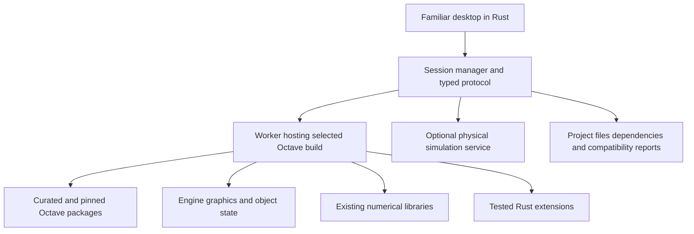

# Integrating open source scientific computing projects

Combine established open-source components into one coherent MATLAB-compatible product. Start by evaluating GNU Octave as the execution engine and selected Octave packages as the initial toolbox collection. Build the familiar desktop, integration protocol and new product features in Rust. This approach prioritizes usable functionality and reliability; the resulting distribution will not be entirely Rust.

Status: the initial architecture is implemented as a Rust desktop and CLI using GNU Octave through a persistent worker. The development machine has Octave and selected control, signal, image, statistics and optimization packages installed; their assertion fixtures have passed through the adapter. The runtime and packages remain external prerequisites. Scilab, OpenModelica and Nelson are assessment candidates for later work and are not integrated. This strategy governs the [development plan](DEVELOPMENT_PLAN.md); the [functionality catalog](FUNCTIONALITY_CATALOG.md) remains the full target scope.

## Component selection

| Component | Proposed role | Work required before adoption |
| --- | --- | --- |
| [GNU Octave](https://octave.org/about) | Primary candidate for executing MATLAB-like source and owning session state. | Measure compatibility on real projects, inspect embedding/debugging hooks, validate graphics integration and packaging. |
| [Octave packages](https://packages.octave.org/) | Curated additions for signal, control, image, statistics, optimization, data types and other domains. | Audit each selected version's coverage, dependencies, license, maintenance and regression tests; resolve namespace collisions. |
| [Octave symbolic](https://octave.sourceforge.io/symbolic/) | Candidate symbolic computation layer using SymPy. | Test MATLAB API differences, assumptions, results and object transport; account for Python/SymPy runtime dependencies. |
| [Scilab and Xcos](https://www.scilab.org/software/xcos) | Evaluate specific simulation capabilities and UX patterns. | Demonstrate a useful, well-defined integration; do not introduce another primary language engine just for nominal feature coverage. |
| [OpenModelica](https://openmodelica.org/) | Optional physical-modeling service with separately defined model interchange. | Validate process/API integration, model semantics, licensing, installation and numerical behavior. |
| [Nelson](https://nelson-lang.github.io/nelson-website/) | Alternative engine candidate to compare during the initial assessment. | Run the same script, file, debugger, graphics and packaging tests; select on evidence. |
| Rust components | Desktop, session management, project tooling, adapters and selected numerical improvements. | Pass familiar-workflow tests and prove any claimed speed or reliability advantage. |

Existing projects provide substantial functionality but do not add up automatically to full MATLAB. Octave documents remaining gaps in [classdef compatibility](https://docs.octave.org/latest/classdef-Classes.html). Xcos supplies hybrid-system modeling, while OpenModelica targets Modelica; neither fact establishes general Simulink or Simscape compatibility. Keep the original compatibility registry and expose all unsupported cases.

## One application and one primary execution engine

The user should see one installer, one familiar desktop, one active workspace, one Help system and one project dependency manifest. A script should not require manual transfers between unrelated applications.

Use one authoritative interpreter per session. It owns function resolution, variables, class instances, handles, random state, callbacks and evaluation order. Specialized services receive explicit requests with well-defined data conversion. Avoid routing arbitrary lines of one script between Octave, Scilab, Python and Rust: equivalent-looking expressions can differ in shape rules, types, state and exceptions.

Octave documents a C++ embedding interface for its interpreter in [Standalone Programs](https://docs.octave.org/latest/Standalone-Programs.html). Prototype a small C++ worker around that interface, with Rust communicating through a versioned process protocol. This is a proposed adapter, not an existing turnkey Rust integration. Pin the engine build and validate the API surface used.

The protocol needs structured execution results, stdout/stderr events, warnings/errors with source locations, variable metadata, paged array reads, edits, interrupts, debugger states and figure events. Do not parse printed matrix text to recover workspace values. Keep large buffers in the worker and request slices; add shared memory only when profiling justifies it.

Closures, handles and arbitrary class instances should remain in their owning worker. When they must cross a service boundary, define an explicit representation or reject the transfer. A JSON object is not a lossless substitute for every MATLAB value.

## Graphics and debugging are early feasibility gates

Preserve existing engine figures for the first functional prototype, including separate windows where needed. A fully integrated figure panel requires deeper event and graphics-object bridging; static plot screenshots do not satisfy figure editing or callbacks.

Octave exposes selectable [graphics toolkits](https://docs.octave.org/latest/Graphics-Toolkits.html), but a new Rust renderer would still require substantial implementation. Test interaction, callbacks, object properties, exports, interruption and OS event loops before choosing the final rendering architecture.

Similarly, prove breakpoints, stepping, stack frames, variable inspection and resume through the worker. If public hooks are insufficient, assess a small maintained upstream contribution or patch rather than assuming terminal command automation yields a dependable debugger.

## Package integration policy

Create a curated distribution rather than installing every available package. Begin with numerical core and a small group of commonly useful packages. Record exact versions, sources, dependencies, licensing and supported APIs in a lockfile.

For every added package:

1. Run the compatibility fixtures and at least one representative user workflow.
2. Check input/output classes, shapes, defaults, warnings and errors against the target profile.
3. Test conflicts with already selected packages and enforce deterministic resolution.
4. Bundle required runtimes where redistribution permits, with reproducible builds and attribution.
5. Integrate its documentation and diagnostics into the familiar desktop.
6. Publish what is supported, partial or unsupported.

Use adapters for API differences that can be faithfully corrected at the boundary. Change the engine when the gap involves syntax, scoping or object semantics; wrapping a function cannot fix those issues. Prefer contributing maintainable changes upstream and carrying only a small downstream patch set.

Open-source licenses differ. Review the exact components and how they are combined before redistribution; process separation is an architectural choice, not an automatic licensing exemption. Octave is GPL-licensed; OpenModelica has its own [licensing terms](https://openmodelica.org/useresresources/license/). Retain required source, notices and build information and select the product license accordingly.

## Rust and performance

Do not translate working components merely to increase the Rust percentage. First profile representative workloads and identify numerical kernels, copies, interpreter overhead or rendering bottlenecks. Replace a component only when its Rust implementation passes conformance tests and improves a measured outcome.

Initially, Octave remains the only source execution engine. Rust extensions may implement selected operations behind explicit, tested adapters. A Rust-native interpreter remains a required long-term workstream in the complete [product roadmap](ROADMAP.md), with its own language, value, numerical and debugger contracts. Develop it as an independently identified backend against the shared conformance corpus; changing the default requires measured correctness and performance evidence. Seamless fallback between two interpreters is not assumed.

A better desktop can improve usability immediately, but placing a Rust UI around Octave does not itself accelerate computations. Publish cold/warm execution, memory use and end-to-end timings, including data conversion and interprocess overhead.

Early integration editions contain non-Rust engines and dependencies; they do not complete the Rust-native execution objective. Deliver the Rust workstream incrementally without dropping the broader compatibility and ecosystem requirements. Declare any remaining native dependencies per edition, and claim a fully Rust distribution only when the actual shipped implementation and dependency boundary support it. This sequence preserves the user's priorities of functionality, reliability and performance while retaining the full long-term scope.

## First delivery and subsequent expansion

The first deliverable is a feasibility prototype: a familiar Rust desktop connected to one pinned engine, executing an unchanged `.m` script, displaying workspace variables and an interactive figure, reporting a source error, interrupting execution, and saving/reloading declared MAT types.

Next, add a tested package collection, debugger integration, reliable installers and migration reports. Then close high-value compatibility gaps and introduce specialized services one domain at a time. Simulation import is a separate project: an imported diagram is not complete until supported blocks, solvers, initial conditions and event ordering produce validated results.

Choose the engine after comparing Octave and, if warranted, Nelson on the same project corpus. Record unmodified scripts passed, unsupported features, file fidelity, debugging/graphics feasibility, runtime/memory and build maintenance. No percentage of MATLAB coverage or speedup is established by the current research.
